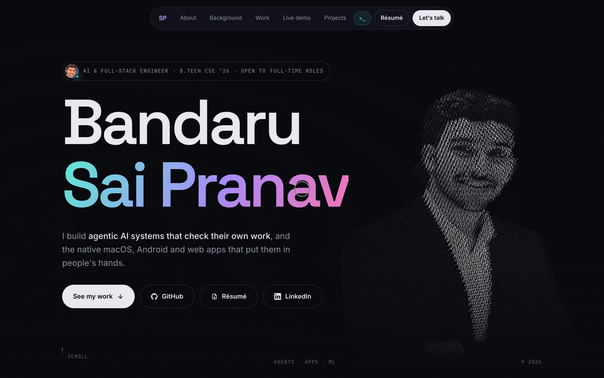
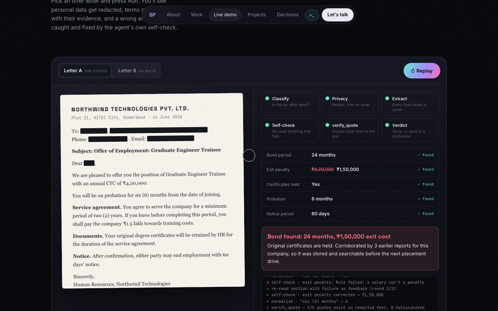
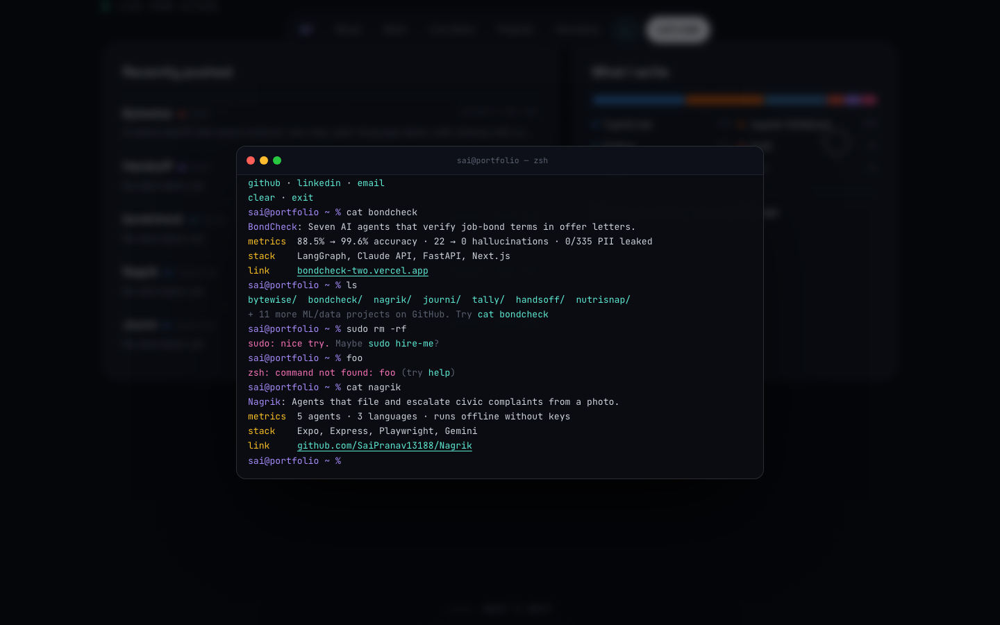

# saipranav13188.github.io

Portfolio of **Bandaru Sai Pranav**, an AI and full-stack engineer who builds agentic AI systems that check their own work.

**Live: https://saipranav13188.github.io**

## What's on it

- **Particle portrait hero.** My photo rebuilt from ~50k Three.js points (custom GLSL): they ripple around the cursor and fold into bands as you scroll.
- **Seven case studies.** Each has the project's real metrics, device mockups, and a link to verify the numbers in the source repo.
- **Live BondCheck demo.** A replay of the multi-agent pipeline that runs in the browser: PII redaction, quote-backed extraction, a self-check that catches and fixes a wrong value, and `verify_quote`.
- **Engineering decisions.** Four trade-offs, each with its problem, choice and cost.
- **Hidden terminal.** Press `~` and try `help`, `ls`, `cat bondcheck` or `sudo hire-me`.
- **Live GitHub feed.** Recently pushed repos and a language breakdown from the GitHub API.

## Built with

Plain HTML, CSS and JavaScript, plus [Three.js](https://threejs.org) and [GSAP](https://gsap.com) loaded from cdnjs. There is no build step. Edit `index.html` and push to `main`, and GitHub Pages redeploys in about a minute.

Accessibility: a skip link, visible keyboard focus, a full mobile menu, and support for `prefers-reduced-motion` (animations and auto-playing demos turn off).

## Contact

[LinkedIn](https://www.linkedin.com/in/sai-pranav-2a3b50303) · [GitHub](https://github.com/SaiPranav13188) · saipranav1388@gmail.com
