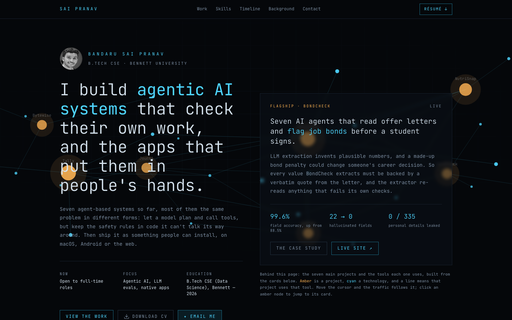
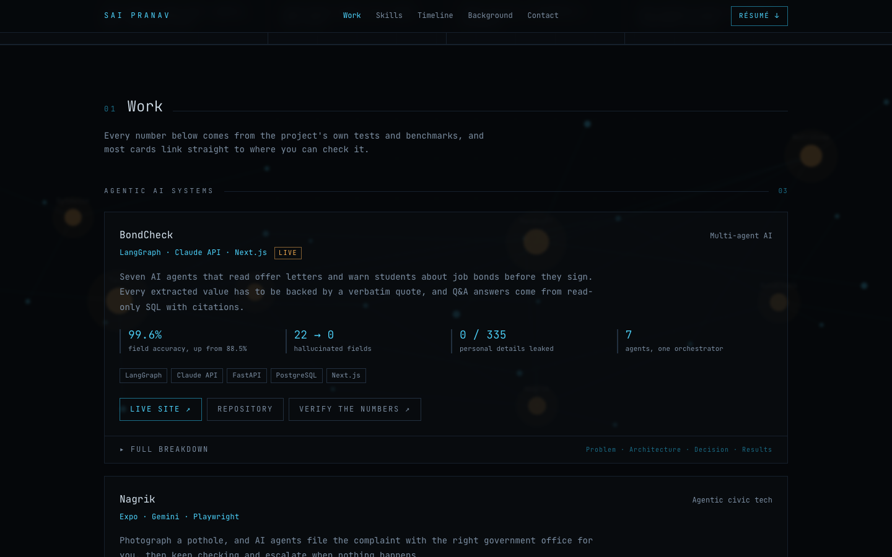

# saipranav13188.github.io

Portfolio of **Bandaru Sai Pranav**, an AI and full-stack engineer who builds agentic AI systems that check their own work.

**Live: https://saipranav13188.github.io**

## What's on it

- **A live project graph behind the page.** Every main project and the tools it uses, drawn on a canvas. Amber nodes are projects, cyan nodes are technologies, and a line means that project actually uses that tool. The graph is built from the project cards on the page, so it can never drift from them. Click a project node to jump to its card.
- **Eight case studies.** Each has its real metrics, its stack, links to verify the numbers in the source repo, and a "Full breakdown" (problem, architecture, key decision and trade-off). The breakdowns are plain `
` elements, so they're readable without JavaScript and by crawlers and ATS parsers.
- **Eleven more ML, data and web projects**, plus Skills, a Timeline, Background and Contact.

## JARVIS

An AI assistant in a side panel ("✦ Ask JARVIS"). Visitors type or speak a question in English, Hindi or Telugu, and it answers out loud, grounded only in [`api/_knowledge.js`](api/_knowledge.js). Every project card has an "Ask JARVIS" button that opens it with a question about that project.

- `api/chat.js` is a Vercel serverless function that calls Google Gemini and streams the answer. The API key lives only in Vercel's environment variables.
- On GitHub Pages (no server), the page sends questions to the Vercel deployment instead.
- Voice uses the browser's own speech recognition and speech synthesis, so it costs no API quota.
- Built-in limits: 25 questions per visitor and 60 per IP address per hour, with automatic fallback to `gemini-3.5-flash-lite` when `gemini-3.8-flash` runs out of quota.

**Setup:** create a free key at [aistudio.google.com/apikey](https://aistudio.google.com/apikey), then in Vercel go to Project → Settings → Environment Variables and add `GEMINI_API_KEY`. Redeploy.

**Run locally with JARVIS:** put `GEMINI_API_KEY=your-key` in `.env.local` (ignored by git), run `node scripts/dev-server.js`, and open http://localhost:3000.

**Change what JARVIS knows:** edit `api/_knowledge.js` and push.

Optional environment variables: `GEMINI_MODEL` (comma-separated fallback list), `MAX_TURNS_PER_SESSION`, `MAX_TURNS_PER_IP_PER_HOUR`.

## Built with

One `index.html`, with plain HTML, CSS and JavaScript and no libraries. The graph's 3D projection, layout and hit-testing are hand-rolled on a 2D canvas. There is no build step: edit `index.html` and push to `main`, and GitHub Pages and Vercel redeploy in about a minute.

To add a project to the graph, give its card a `data-node="Name"` attribute and list its tools in its `.stack` list.

Accessibility: a skip link, visible keyboard focus, real headings and lists, and `prefers-reduced-motion` support (the graph is drawn once and stays still, and reveal animations turn off).

## Contact

[LinkedIn](https://www.linkedin.com/in/sai-pranav-2a3b50303) · [GitHub](https://github.com/SaiPranav13188) · saipranav1388@gmail.com
